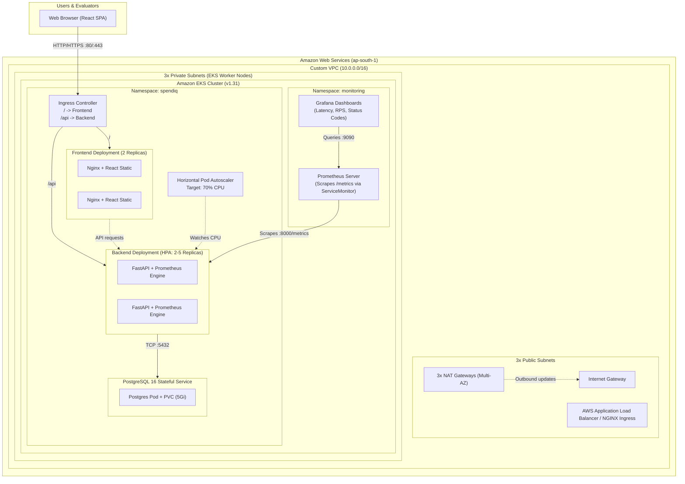

# SpendIQ — Enterprise Personal Finance SaaS (DevOps Capstone)

[](https://github.com/devops/spendiq/actions/workflows/ci-cd.yaml)
[](LICENSE)
[](https://kubernetes.io/)
[](https://www.terraform.io/)
[](https://www.python.org/)
[](https://react.dev/)

> **Mission**: A production-ready, cloud-native DevOps capstone project built on AWS EKS, featuring multi-stage Docker containerization, Aqua Trivy DevSecOps scanning, GitHub Actions CI/CD with GHCR registry publishing, Helm zero-downtime packaging, Horizontal Pod Autoscaling (HPA), and full-stack Prometheus/Grafana observability.

---

## 1. System Architecture



---

## 2. Technology Stack

| Layer | Technologies & Tools |
| :--- | :--- |
| **Frontend** | React 18, Vite, Recharts, Axios, NGINX 1.27 Alpine (production runtime) |
| **Backend** | Python 3.12+, FastAPI, SQLAlchemy, Alembic, Pydantic v2, Pytest |
| **Database** | PostgreSQL 16 Alpine, PersistentVolumeClaim (5Gi) |
| **Containerization** | Docker, Docker Compose, Multi-stage builds, non-root users (`appuser:1001`) |
| **Security (DevSecOps)** | Aqua Security Trivy (scans HIGH & CRITICAL CVEs), Least-privilege IAM |
| **CI/CD** | GitHub Actions, GitHub Container Registry (GHCR), SemVer & Git SHA tagging |
| **IaC** | Terraform 1.9+, AWS VPC Module, AWS EKS Module, AWS S3/DynamoDB state locking |
| **Cloud Provider** | AWS (Region: `ap-south-1`) |
| **Kubernetes & Packaging** | Helm 3+, Kubernetes Ingress NGINX, Horizontal Pod Autoscaler (HPA v2) |
| **Observability** | Prometheus, CoreOS ServiceMonitor, Grafana |

---

## 3. Repository Directory Structure

```
c:\devopsproject\
├── .github/
│   └── workflows/
│       └── ci-cd.yaml              # Complete CI/CD: Test, Build, Trivy scan, GHCR, Helm deploy
├── backend/
│   ├── app/
│   │   ├── api/routes.py           # REST endpoints (health, ready, CRUD transactions, budgets, seed)
│   │   ├── models/models.py        # SQLAlchemy Transaction and Budget models
│   │   ├── schemas/schemas.py      # Pydantic validation schemas
│   │   ├── services/services.py    # Business logic & analytics aggregations
│   │   ├── database.py             # Database engine & connection health check
│   │   └── main.py                 # FastAPI application, Prometheus middleware & /metrics
│   ├── alembic/                    # Database migrations
│   │   └── versions/001_initial.py # Initial migration creating schema & enums
│   ├── tests/                      # Automated Pytest suite
│   │   ├── conftest.py             # SQLite memory database isolation fixture
│   │   ├── test_health.py          # /health & /ready endpoint tests
│   │   ├── test_transactions.py    # Comprehensive CRUD transaction tests
│   │   └── test_budgets_analytics.py # Budget and spending analytics tests
│   ├── Dockerfile                  # Multi-stage build with non-root user
│   ├── entrypoint.sh               # Migration runner and server entrypoint
│   ├── requirements.txt            # Pinned dependencies
│   └── pytest.ini                  # Pytest configuration & coverage options
├── frontend/
│   ├── src/
│   │   ├── api/api.js              # Centralized Axios client with interceptors
│   │   ├── components/             # Layout, Navbar, StatCard, Modal, LoadingSpinner
│   │   ├── pages/                  # Dashboard, Transactions, Budgets
│   │   ├── App.jsx                 # Client-side router configuration
│   │   └── main.jsx                # React DOM entry
│   ├── public/spendiq-icon.svg    # Brand asset and favicon
│   ├── Dockerfile                  # Multi-stage build (Node -> Nginx production)
│   ├── nginx.conf                  # SPA fallback, gzip compression, security headers
│   └── package.json                # Dependencies and build scripts
├── terraform/                      # AWS Infrastructure as Code
│   ├── versions.tf                 # Provider constraints (AWS, K8s, Helm)
│   ├── providers.tf                # AWS provider and EKS authentication
│   ├── variables.tf                # Configurable variables with validation
│   ├── terraform.tfvars.example    # Safe template values
│   ├── vpc.tf                      # 3 Public + 3 Private Subnets, NAT Gateways, Route Tables
│   ├── eks.tf                      # EKS 1.31 cluster, managed node group, IAM roles
│   ├── outputs.tf                  # Cluster endpoint, VPC ID, kubeconfig helper
│   └── README.md                   # Terraform runbook
├── k8s/
│   └── namespace.yaml              # Kubernetes namespace manifest (`spendiq`)
├── helm/
│   └── spendiq/                   # Complete Helm chart
│       ├── Chart.yaml              # Chart metadata
│       ├── values.yaml             # Production values
│       ├── values-dev.yaml         # Development overrides
│       └── templates/              # Deployment, Service, HPA, Ingress, PVC, ServiceMonitor
├── monitoring/
│   ├── prometheus-values.yaml      # Prometheus Helm configuration
│   ├── grafana-values.yaml         # Grafana Helm configuration with datasource
│   └── grafana-dashboard.json      # Production observability dashboard
├── scripts/
│   ├── load_test.sh                # Bash HPA CPU stress test generator
│   └── load_test.py                # Cross-platform Python HPA load tester
├── troubleshooting/
│   └── README.md                   # 5 real-world operational failure runbooks
├── demo/
│   ├── presentation.md             # Slide deck content and presenter voiceover script
│   ├── checklist.md                # Step-by-step CLI demonstration checklist
│   └── evidence/README.md          # 100-mark evidence capture instructions & matrix
├── docker-compose.yml              # Local 3-tier container orchestration
├── .env.example                    # Environment variable template
├── .gitignore                      # Security-hardened git exclusion rules
├── Makefile                        # Convenience development and test targets
└── README.md                       # Master project documentation
```

---

## 4. Quick Start — Local Development (Docker Compose)

### 4.1 Prerequisites
- Docker Engine 24+ & Docker Compose v2+
- Python 3.12+ (for local testing)
- Node.js 20+ / npm 10+ (for frontend dev)

### 4.2 Starting the Complete Stack
```bash
# 1. Clone repository
git clone https://github.com/devops/spendiq.git
cd spendiq

# 2. Copy environment template
cp .env.example .env

# 3. Build and run all services in background
docker compose up -d --build

# 4. Verify healthy status of all 3 containers
docker compose ps
```

The application will be accessible at:
- **Frontend Dashboard**: [http://localhost:3000](http://localhost:3000)
- **Backend API & Swagger Docs**: [http://localhost:8000/docs](http://localhost:8000/docs)
- **Health Check**: [http://localhost:8000/health](http://localhost:8000/health)
- **Readiness Check**: [http://localhost:8000/ready](http://localhost:8000/ready)
- **Prometheus Metrics**: [http://localhost:8000/metrics](http://localhost:8000/metrics)

### 4.3 Populate Sample Data
Click the **"Seed Demo Data"** button on the frontend or execute:
```bash
curl -X POST http://localhost:8000/api/seed
```

---

## 5. Automated Testing & Code Quality

SpendIQ enforces strict test coverage with database isolation. Tests use an SQLite in-memory database to prevent test pollution of PostgreSQL data.

```bash
# Navigate to backend and run pytest
cd backend
pytest -v --cov=app --cov-report=term-missing
```

**Test Coverage Highlights**:
- `test_health.py`: Liveness (`/health`) and database-aware readiness (`/ready`).
- `test_transactions.py`: Complete CRUD suite (POST, GET, PUT, DELETE), validation errors (negative amounts, missing fields, invalid enums), and search/pagination filters.
- `test_budgets_analytics.py`: Monthly budget operations, expense category breakdowns, income summaries, and monthly trends.

---

## 6. Cloud Deployment (Terraform & AWS EKS)

### 6.1 Provision Cloud Infrastructure
```bash
cd terraform

# 1. Initialize Terraform
terraform init

# 2. Validate syntax
terraform validate

# 3. Plan infrastructure
terraform plan -var-file="terraform.tfvars.example" -out=tfplan

# 4. Provision VPC, EKS Cluster & Node Groups
terraform apply tfplan

# 5. Connect kubectl to your new cluster
aws eks update-kubeconfig --region ap-south-1 --name spendiq-eks
kubectl get nodes
```

### 6.2 Deploy Application with Helm
```bash
# Lint the chart
helm lint ./helm/spendiq

# Install or upgrade SpendIQ in its dedicated namespace
helm upgrade --install spendiq ./helm/spendiq \
  --namespace spendiq \
  --create-namespace \
  --wait \
  --timeout 10m

# Verify running resources
kubectl get pods,svc,pvc,ingress,hpa -n spendiq
```

---

## 7. Autoscaling Demonstration (HPA)

The SpendIQ backend deployment automatically scales based on CPU utilization (threshold: 70%):

```bash
# Terminal 1: Watch autoscaling
kubectl get hpa spendiq-backend-hpa -n spendiq -w

# Terminal 2: Run CPU load generator (spikes concurrent traffic)
python scripts/load_test.py http://<INGRESS_OR_SERVICE_IP>/api/transactions 25 120
```
**Observed Result**: Backend pods automatically scale from 2 replicas to 5 replicas. Once traffic subsides, the HPA gracefully cools down back to 2 replicas.

---

## 8. Observability (Prometheus & Grafana)

1. Deploy Prometheus and Grafana:
```bash
helm repo add prometheus-community https://prometheus-community.github.io/helm-charts
helm repo update

# Install Prometheus Stack
helm install prometheus prometheus-community/kube-prometheus-stack \
  --namespace monitoring --create-namespace \
  -f monitoring/prometheus-values.yaml

# Install Grafana
helm install grafana grafana/grafana \
  --namespace monitoring \
  -f monitoring/grafana-values.yaml
```

2. Access the Grafana Dashboard:
```bash
kubectl port-forward svc/grafana 3000:80 -n monitoring
```
- Open [http://localhost:3000](http://localhost:3000) (User: `admin` / Password: `spendiq_grafana_admin_password`).
- Open **SpendIQ - Production Observability Dashboard** to monitor real-time Request Rate, P95 Latency, and Error Rates.

---

## 9. Teardown & Cost Management

To avoid ongoing AWS charges after evaluation:
```bash
# 1. Uninstall Helm releases
helm uninstall spendiq -n spendiq
helm uninstall prometheus -n monitoring
helm uninstall grafana -n monitoring

# 2. Destroy AWS Infrastructure
cd terraform
terraform destroy -auto-approve
```

---

## 10. Rubric Traceability Summary

See [`demo/evidence/README.md`](demo/evidence/README.md) for the complete 100/100 mark verification matrix and screenshot capture instructions.
